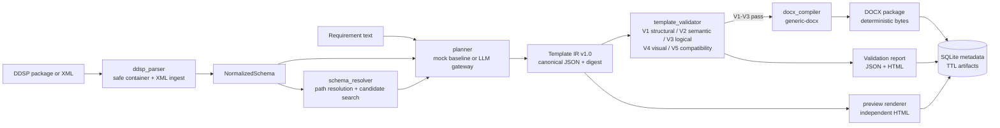

# Docentric Copilot

**Schema-aware template engineering for enterprise document automation.**

Docentric Copilot turns a natural-language requirement plus a DDSP data source package into a
versioned, typed **Template IR**, validates that IR at five levels, and compiles a deterministic
**generic DOCX** document — without Microsoft Word, a Docentric Designer session or a Dynamics 365
environment.

> **Compatibility status: unverified.** This build produces *generic* DOCX documents. It does not
> claim, and must not be read as claiming, compatibility with Docentric AX. The Docentric AX adapter
> is gated and always fails closed (`target_unsupported`, HTTP 409, exit code 4); the validation
> report always records Docentric AX compatibility as `not_tested`. See
> [docs/DOCENTRIC_AX_COMPATIBILITY.md](docs/DOCENTRIC_AX_COMPATIBILITY.md).

---

## The problem

Business documents (quotations, invoices, purchase orders) are usually produced from a typed data
package by a template that is maintained by hand in a graphical designer. Three things go wrong
repeatedly:

1. **Bindings drift from the schema.** A template references a field that the data source no longer
   exposes; nobody notices until a customer receives a broken document.
2. **Templates are opaque.** The artefact is a binary document, so review, diffing and automated
   testing are hard.
3. **AI-generated templates are unaccountable.** A model can produce plausible-looking bindings
   that do not exist, and a document that renders without error is not the same as a document that
   is correct.

## The solution

The project implements a narrow, testable pipeline around one contract — the Template IR:

- **Evidence-based DDSP ingestion.** A DDSP package is parsed as untrusted input (ZIP + XML) with
  hard size, entry, depth and node limits, no DTD/entity processing and no network access. The
  parser records *what it saw* instead of guessing a proprietary layout.
- **Typed intermediate representation.** Every dynamic value is a dotted schema path that the
  validator can resolve. There is no XPath, no code, no raw OOXML in the IR.
- **Deterministic repair.** Whatever a planner produces is post-processed: a binding that does not
  resolve against the schema is removed and reported, never "fixed" by guesswork.
- **Five validation levels.** V1 structural, V2 semantic, V3 logical, V4 visual and V5
  compatibility. `not_tested` is a first-class status and is not an alias for `passed`.
- **Deterministic compilation.** The same IR and sample data always produce a byte-identical DOCX
  package: fixed ZIP timestamps, sorted entries, fixed core properties, no clock and no randomness.
- **Provider-independent planning.** OpenAI, Anthropic and Gemini adapters share one structured
  output contract, plus a deterministic `mock` baseline that needs no API key.

## Status

MVP under active development (version `0.1.0`, Template IR `1.0`). Honest summary:

| Area | State |
| --- | --- |
| DDSP parsing, schema discovery, sample-data extraction | Implemented; exercised only on synthetic packages under `examples/` |
| Template IR + canonical JSON/digest + JSON Schema export | Implemented |
| Deterministic baseline planner (`mock`) | Implemented |
| LLM gateway (OpenAI, Anthropic, Gemini) | Implemented; **no live provider call is verified in this repository** |
| Validation V1–V3 | Implemented |
| Validation V4 (visual) | Partial: table-width check only, and only when sample data is supplied |
| Validation V5 (Docentric AX compatibility) | Not implemented; always `not_tested` |
| Generic DOCX compiler | Implemented; byte-identical output verified by repeated runs |
| Docentric AX compiler | Not implemented; gated and fails closed |
| HTML preview | Implemented; content preview only, not a Word-faithful layout |
| HTTP API, CLI, SQLite storage, artifact TTL | Implemented |
| Evaluation harness (`docentric_copilot.evaluation`) | Not available: the package is a placeholder |
| Benchmarks | Not available: `benchmarks/` has no runner yet |
| Web UI (`apps/web`) | In progress in a separate workstream; not part of this revision's verified surface |
| Docker image, Makefile, CI workflow | Not present in the repository |

The precise mapping of requirements to code and tests is in [docs/SRS.md](docs/SRS.md).

## Architecture



Layer boundaries, package responsibilities and the determinism strategy are described in
[docs/ARCHITECTURE.md](docs/ARCHITECTURE.md).

## Quick start

### Local (supported)

Requires Python 3.12+.

```bash
python3.12 -m venv .venv
source .venv/bin/activate
pip install -e ".[dev]"

docentric-copilot version
# docentric-copilot 0.1.0 (IR 1.0)
```

Start the API (the only optional dependency for the demo is the mock provider, which is always
available):

```bash
uvicorn docentric_copilot.api.main:app --reload --port 8000
```

Interactive OpenAPI UI: <http://localhost:8000/docs>. OpenAPI document: `/openapi.json`.

```bash
curl -s http://localhost:8000/api/v1/health
# {"status":"ok","version":"0.1.0","environment":"development","docentric_ax_adapter_enabled":false}
```

Runtime data (SQLite database and artifacts) is written to `DC_DATA_DIR` (`./.data` by default) and
expires after `DC_ARTIFACT_TTL_SECONDS` (3600 by default).

### Docker (not available at this revision)

There is **no** `Dockerfile`, `docker-compose.yml` or published image in this repository. The
container path is therefore unsupported: no image is built or tested. If you need an isolated
environment today, use any Python 3.12 base image and run the same four commands as above
(`pip install -e .`, `uvicorn docentric_copilot.api.main:app --host 0.0.0.0 --port 8000`); this is
an equivalent manual recipe, not a maintained artefact. Containerisation is tracked in
[docs/ROADMAP.md](docs/ROADMAP.md).

## End-to-end example (quotation)

The repository ships three synthetic packages. `examples/quotation/sales-quotation.ddsp` is a ZIP
containing `manifest.json`, `schema/schema.xsd` and `data/sample.xml`; it contains no third-party or
customer data (see [examples/quotation/README.md](examples/quotation/README.md)).

```bash
mkdir -p out

# 1. Inspect: discover sections, fields, collections and sample data.
docentric-copilot inspect examples/quotation/sales-quotation.ddsp
# Schema: sales_quotation
# Sections: MainData, GeneralData, Parameters
# Fields: 34 nodes · 28 scalars · 1 collections · depth 3
# Sample data: yes
#   [INFO002] info: ZIP container with 3 entries
#   [INFO002] info: Manifest detected: docentric-ax-ddsp (manifest.json)
#   [INFO002] info: Sample data loaded from 'data/sample.xml'

# 2. Plan: requirement -> Template IR (mock baseline; no credentials needed).
docentric-copilot plan \
  --ddsp examples/quotation/sales-quotation.ddsp \
  --prompt-file examples/quotation/prompt.txt \
  --output out/plan.json \
  --mapping out/mapping.json

# 3. Validate: V1-V5 report for the IR.
docentric-copilot validate \
  --ddsp examples/quotation/sales-quotation.ddsp \
  --plan out/plan.json \
  --report out/validation.html \
  --json-report out/validation.json

# 4. Compile: deterministic generic DOCX (no model calls).
docentric-copilot compile \
  --ddsp examples/quotation/sales-quotation.ddsp \
  --plan out/plan.json \
  --output out/quotation.docx

# 5. Optional: independent HTML preview of the data substitution.
docentric-copilot preview \
  --ddsp examples/quotation/sales-quotation.ddsp \
  --plan out/plan.json \
  --output out/preview.html
```

Observed output of step 2 (this build, mock provider):

```text
IR written to out/plan.json (9f8d8ad173de)
Validation: {'structural': 'passed', 'semantic': 'passed', 'logical': 'passed',
             'visual': 'skipped', 'docentric_compatibility': 'not_tested'}
Mapping: {'resolved': 11, 'ambiguous': 0, 'missing': 0, 'invalid': 0}
```

Observed output of step 4:

```text
Compiled out/quotation.docx (39749 bytes)
Validation: {'structural': 'passed', 'semantic': 'passed', 'logical': 'passed',
             'visual': 'passed', 'docentric_compatibility': 'not_tested'}
Docentric AX compatibility: not tested
```

The IR digest and the exact byte count are reproducible for a given compiler version; they change
when the IR or the compiler changes, so treat them as a fingerprint of *this* build rather than a
constant.

To see the compatibility gate in action:

```bash
docentric-copilot compile \
  --ddsp examples/quotation/sales-quotation.ddsp \
  --plan out/plan.json \
  --output out/quotation-ax.docx \
  --target docentric-ax
# error [target_unsupported]: The Docentric AX compiler is not available: ...
# exit code 4
```

The same request over HTTP returns `409` with error code `target_unsupported` (see
[docs/API_SPEC.md](docs/API_SPEC.md)).

## Feature matrix

| Capability | State | Where |
| --- | --- | --- |
| DDSP ZIP container ingestion with limits | Implemented | `packages/ddsp-parser/src/docentric_copilot/ddsp_parser/safety.py` |
| XSD → normalized schema | Implemented | `packages/ddsp-parser/src/docentric_copilot/ddsp_parser/xsd.py` |
| Schema inference from sample XML (`SCHEMA006`) | Implemented | `packages/ddsp-parser/src/docentric_copilot/ddsp_parser/sampledata.py` |
| Sample-data coercion by schema type | Implemented | `packages/ddsp-parser/src/docentric_copilot/ddsp_parser/sampledata.py` |
| Path resolution with repeat-alias scoping | Implemented | `packages/schema-resolver/src/docentric_copilot/schema_resolver/paths.py` |
| Deterministic candidate search / baseline mapping | Implemented | `packages/schema-resolver/src/docentric_copilot/schema_resolver/search.py` |
| Template IR v1.0 + canonical JSON + digest | Implemented | `packages/template-ir/src/docentric_copilot/template_ir/canonical.py` |
| LLM gateway: OpenAI / Anthropic / Gemini / mock | Implemented; live calls unverified | `packages/llm-gateway/src/docentric_copilot/llm/` |
| Deterministic mock planner | Implemented | `packages/planner/src/docentric_copilot/planner/heuristic.py` |
| Deterministic repair of unresolvable bindings | Implemented | `packages/planner/src/docentric_copilot/planner/service.py` |
| Revision diff between IR versions | Implemented | `packages/planner/src/docentric_copilot/planner/revisions.py` |
| V1 structural / V2 semantic / V3 logical validation | Implemented | `packages/template-validator/src/docentric_copilot/template_validator/engine.py` |
| V4 visual validation (table width) | Partial (needs sample data) | same file |
| V5 Docentric AX compatibility | **Not tested** | same file |
| Generic DOCX compiler | Implemented | `packages/docx-compiler/src/docentric_copilot/docx_compiler/generic.py` |
| Deterministic ZIP normalisation | Implemented | `packages/docx-compiler/src/docentric_copilot/docx_compiler/package.py` |
| HTML preview | Implemented (content only) | `packages/renderer/src/docentric_copilot/preview/renderer.py` |
| HTTP API | Implemented | `services/api/src/docentric_copilot/api/` |
| CLI | Implemented | `services/api/src/docentric_copilot/cli/main.py` |
| SQLite storage + artifact TTL | Implemented | `services/api/src/docentric_copilot/storage/store.py` |
| PDF export | Not implemented | — |
| Docentric AX compiler | Blocked / not implemented | `packages/docx-compiler/src/docentric_copilot/docx_compiler/generic.py` |
| Evaluation harness | Not available | `packages/evaluation/src/docentric_copilot/evaluation/__init__.py` (placeholder) |
| Benchmarks | Not available | `benchmarks/` (empty) |
| Authentication / multi-tenancy | Not implemented | — |

## Compatibility matrix

| Target | Compiler available | Compatibility claimed | Evidence |
| --- | --- | --- | --- |
| `generic-docx` (plain OOXML) | Yes | OOXML structure only; not opened in Microsoft Word by the test suite | `inspect_package()` checks required entries, macros, embedded objects, external relationships |
| `docentric-ax` | No | **None** — unverified | Always raises `UnsupportedTargetError`; V5 report status `not_tested` |

The word "verified" appears in the `/api/v1/capabilities` payload with a narrow meaning: it states
whether that compiler target is implemented and internally checked (`generic-docx`), not whether the
output is compatible with any third-party product. For `docentric-ax` both `available` and `verified`
are `false`.

## Project structure

One distribution, several source roots. Each package directory owns exactly one subpackage of the
`docentric_copilot` namespace (configured in [pyproject.toml](pyproject.toml)).

```text
packages/
  core/             docentric_copilot          config, errors, ids, logging, serialization
  ddsp-parser/      docentric_copilot.ddsp_parser
  schema-resolver/  docentric_copilot.schema_resolver
  template-ir/      docentric_copilot.template_ir
  template-validator/ docentric_copilot.template_validator
  docx-compiler/    docentric_copilot.docx_compiler
  llm-gateway/      docentric_copilot.llm
  planner/          docentric_copilot.planner
  renderer/         docentric_copilot.preview
  evaluation/       docentric_copilot.evaluation   (placeholder)
services/
  api/              docentric_copilot.app / .api / .cli / .storage
examples/           synthetic DDSP packages: quotation, invoice, purchase-order
scripts/            build_examples.py (deterministic example generator)
tests/              pytest suite (see docs/TEST_PLAN.md)
apps/web/           web frontend workstream (in progress)
docs/               product, architecture, API, security and planning documents
```

## Testing

There is no `Makefile`, so `make test` is not available. The pytest suite is the source of truth:

```bash
pytest                                   # whole suite
pytest -q tests/unit                      # fast unit tests
pytest --cov=docentric_copilot --cov-report=term-missing
ruff check .
mypy packages services
```

Markers declared in [pyproject.toml](pyproject.toml): `slow`, `e2e`, `network` (network tests are
expected to be skipped; no test may depend on a real provider). `npm test` is not available at this
revision because `apps/web` has no committed package manifest.

What is and is not covered is listed in [docs/TEST_PLAN.md](docs/TEST_PLAN.md).

## Documentation

| Document | Purpose |
| --- | --- |
| [docs/PRD.md](docs/PRD.md) | Problem, personas, scope, principles, success metrics |
| [docs/SRS.md](docs/SRS.md) | FR-01…FR-10 and NFR-01…NFR-12 with status and evidence |
| [docs/ARCHITECTURE.md](docs/ARCHITECTURE.md) | Layers, data flow, package boundaries, determinism |
| [docs/TEMPLATE_IR.md](docs/TEMPLATE_IR.md) | Every IR entity and field, path/alias/expression/format semantics |
| [docs/API_SPEC.md](docs/API_SPEC.md) | Endpoints, error envelope, artifact lifecycle |
| [docs/DDSP_COMPATIBILITY.md](docs/DDSP_COMPATIBILITY.md) | What is known and unknown about DDSP, diagnostics, limits |
| [docs/DOCENTRIC_AX_COMPATIBILITY.md](docs/DOCENTRIC_AX_COMPATIBILITY.md) | The compatibility gate and explicit non-claims |
| [docs/THREAT_MODEL.md](docs/THREAT_MODEL.md) | Assets, actors, threats, mitigations, residual risk |
| [docs/TEST_PLAN.md](docs/TEST_PLAN.md) | Test matrix, how to run, coverage |
| [docs/EVALUATION.md](docs/EVALUATION.md) | Metric definitions and the (not yet available) harness |
| [docs/BENCHMARKS.md](docs/BENCHMARKS.md) | Benchmark methodology (runner not yet available) |
| [docs/FEASIBILITY.md](docs/FEASIBILITY.md) | M0 findings and the recorded compatibility decision |
| [docs/ROADMAP.md](docs/ROADMAP.md) | M0–M5 milestones, next steps, blocked items |
| [docs/adr/](docs/adr/) | Architecture decision records |
| [CONTRIBUTING.md](CONTRIBUTING.md) | Development workflow and Definition of Done |
| [SECURITY.md](SECURITY.md) | Vulnerability reporting and supported versions |

## Licence

Apache License 2.0 — see [LICENSE](LICENSE).

## Independence disclaimer

This project is independent. It is **not** affiliated with, endorsed by, sponsored by or supported
by Docentric or Microsoft. "Docentric", "Microsoft", "Dynamics 365" and "Word" are trademarks of
their respective owners and are used here only to describe interoperability questions. No
third-party Docentric asset, template or customer data is included; every example package under
`examples/` is synthetic and generated by
[scripts/build_examples.py](scripts/build_examples.py).
