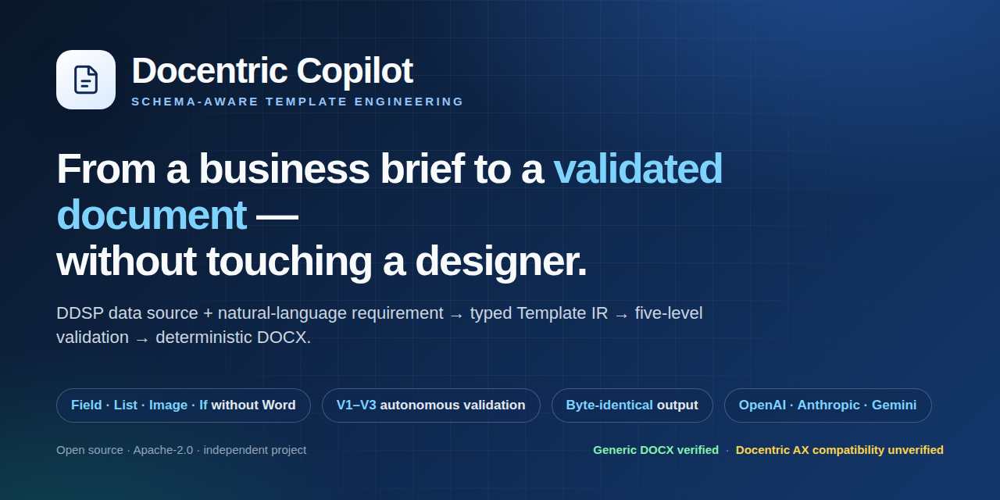
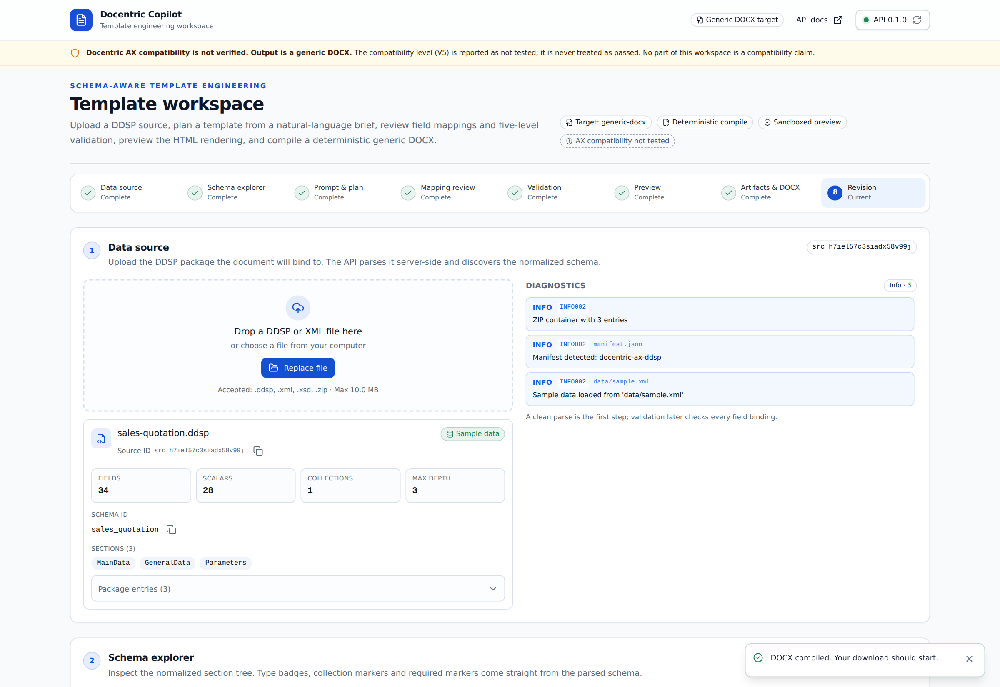
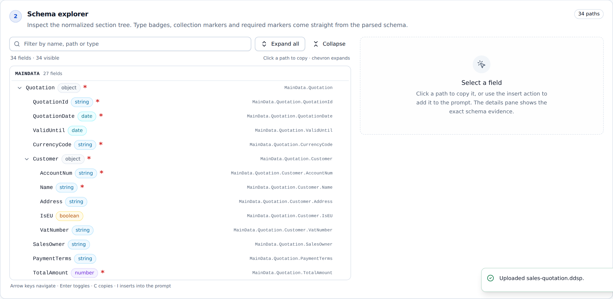
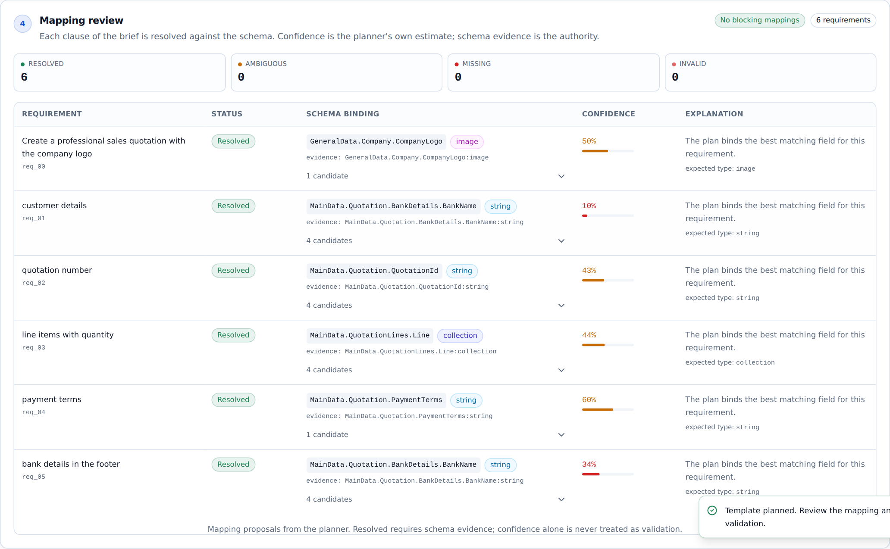
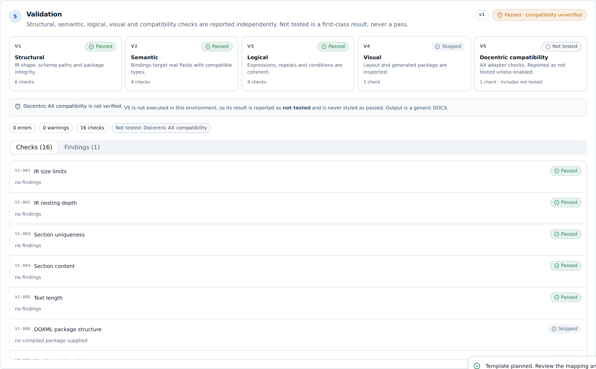
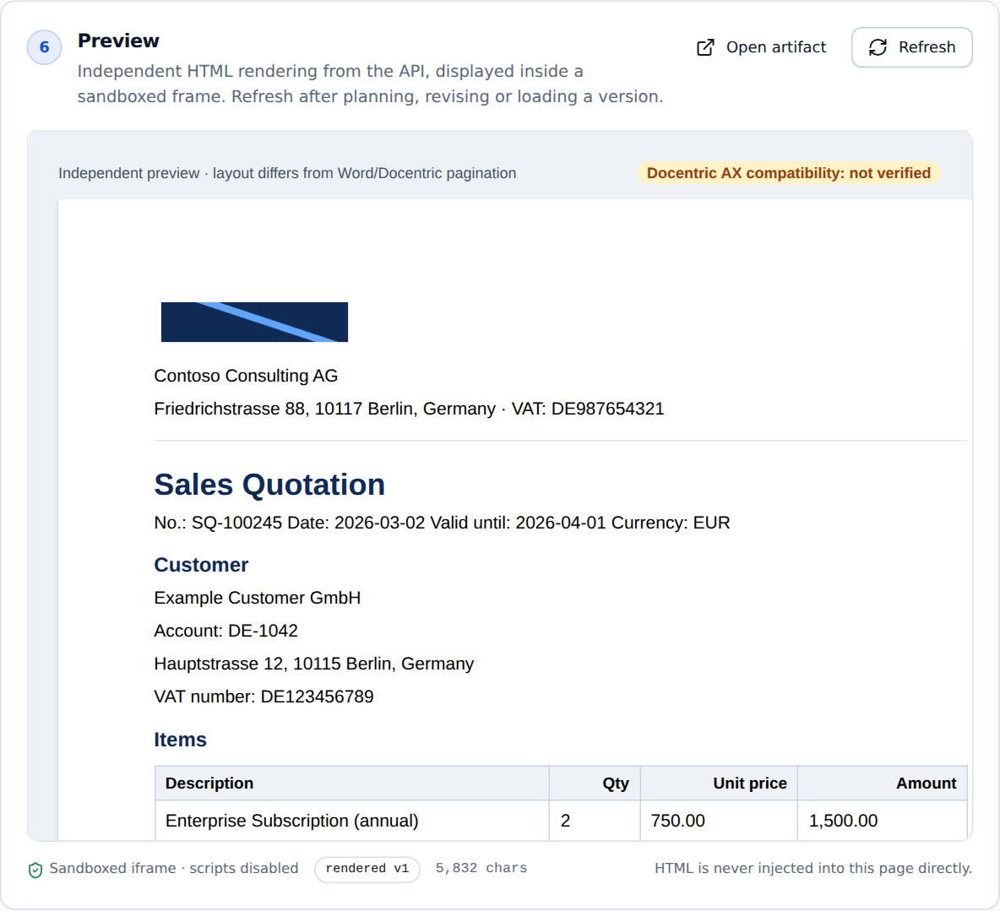
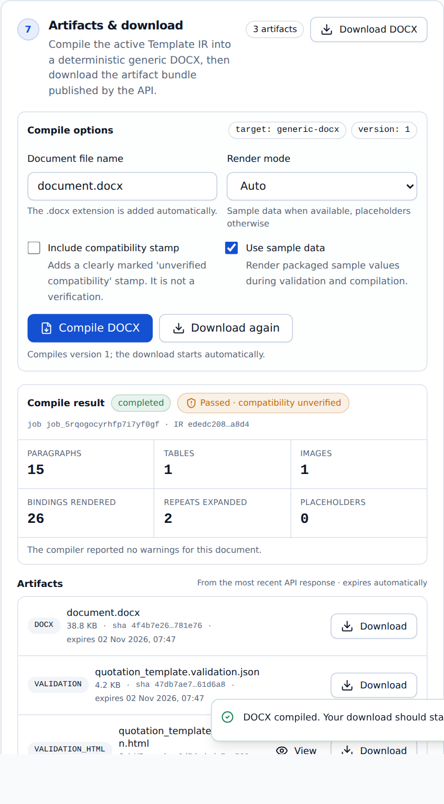
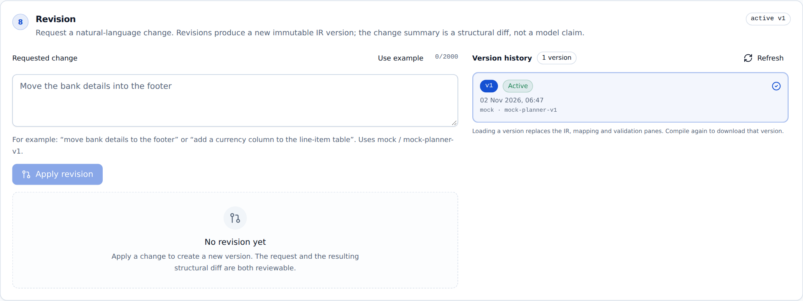

# Docentric Copilot

### Turn a business brief and a data source into a finished, checked document — in minutes.

[](https://github.com/SergeyGer/Docentric-Copilot/actions/workflows/ci.yml)
[](https://github.com/SergeyGer/Docentric-Copilot/releases)
[](LICENSE)
[](docs/media/demo-v3.mp4)
[](https://docentric-copilot-bqpx8652tmmliwk9c2d5rq.streamlit.app)
[](https://github.com/SergeyGer/Docentric-Copilot/wiki)
[](https://github.com/SergeyGer/Docentric-Copilot/wiki/Docentric-AX-Compatibility)



**Docentric Copilot** is an open-source AI assistant for enterprise document production. You give it a data
source and describe the document you need in plain language. It answers with a finished Word document, a
reviewable plan of every decision it made, and a validation report that tells you exactly what was checked —
and what wasn't.

No designer sessions. No manual field hunting. No surprises in front of a customer.

---

## Configure an AI provider

The deterministic `mock` provider needs no key. To use a real model, create `.env` from the template
and fill in the key:

```bash
cp .env.example .env      # then edit .env
uvicorn docentric_copilot.api.main:app --port 8000
```

`GET /api/v1/providers` reports which providers are configured. `.env` is git-ignored; real
environment variables always override it. Without a key the application keeps working offline.

## Try it now

**[Open the live demo →](https://docentric-copilot-bqpx8652tmmliwk9c2d5rq.streamlit.app)**

The Streamlit demo runs the real pipeline — schema parsing, requirement mapping, validation, DOCX
compilation and revision — on the deterministic provider. No API key, no model calls, nothing to install.

| You can | What you see |
| --- | --- |
| Pick a bundled package | Sales quotation, tax invoice or purchase order with sample data |
| Inspect the plan | Every requirement, its concept, placement and confidence |
| Review a mapping | Nine confirmed bindings and one genuine ambiguity, resolved by you |
| Download the document | A real `.docx`, compiled from the validated template |
| Change it in plain language | A targeted revision with a before/after preview |
| Check the evidence | Validation statuses and the honest `not tested` compatibility note |

Prefer to watch first? **[Watch the 2:46 demo video](docs/media/demo-v3.mp4)** — a typed brief, live
routing, an honest multi-provider benchmark on the same cases, zoomed document checks and revision.

Prefer to run it yourself? `streamlit run streamlit_app.py` serves the same demo locally.

---

## How it works

| Step | You | The Copilot |
| --- | --- | --- |
| **1** | Upload the data source (`.ddsp`) | Shows every available field, type and repeating table |
| **2** | Describe the document in one paragraph | Proposes a complete document structure and links each requirement to a real field |
| **3** | Review the decisions | Explains every choice, flags anything ambiguous, never invents a field |
| **4** | Download | Delivers DOCX + plan + mapping + validation report |

```text
   Your brief                          The Copilot                          Your document
   ──────────                          ───────────                          ─────────────
   "A sales quotation         →   field-by-field plan + checks   →   quotation.docx
    with logo, items,                                                     plan.json
    totals and bank details"                                              validation.html
```

---

## A five-minute result, not a five-day template



Everything happens in one workspace: the data source, a searchable schema explorer, the brief, the
field-mapping review, five independent validation levels, a live document preview, the download bundle, and
a revision box that produces a new version instead of silently editing a file.

---

## What makes it different

| | |
| --- | --- |
| **It refuses to guess.** | If a field does not exist in your data, it cannot appear in your document. The plan is rejected or the binding is removed and reported — never fabricated. |
| **You can see the reasoning.** | Every requirement maps to a concrete field, with alternatives, a confidence score and the evidence behind the choice. |
| **Documents become testable.** | The same inputs always produce the same file, byte for byte. You can diff, archive and regression-test a document like code. |
| **It is honest about compatibility.** | It tells you plainly what it has verified and what it has not. No green check marks for things nobody tested. |
| **It runs without a cloud.** | A built-in offline assistant produces deterministic results with no API key — perfect for demos, reviews and CI. |
| **You choose the AI.** | OpenAI, Anthropic and Google Gemini are supported behind one interface; nothing is sent anywhere unless you configure it. |

---

## See it

| Schema explorer | Mapping review |
| --- | --- |
|  |  |
| **Every field, typed and searchable** — with keyboard navigation and one-click path insertion. | **Every decision, explained** — requirement, chosen field, alternatives and confidence. |

| Validation | Preview |
| --- | --- |
|  |  |
| **Five independent checks** — structure, meaning, logic, layout and compatibility, each reported separately. | **See the document before you compile it**, rendered from the real sample data. |

| Download bundle | Revision |
| --- | --- |
|  |  |
| **DOCX plus evidence** — the document, its plan, the mapping and the validation report. | **Change by describing the change** — a new version, a visible diff, and one-click rollback. |

---

## Who it is for

- **Functional consultants** who need a customer-ready document that matches a written requirement.
- **Template designers** who want a correct starting skeleton and a fast review loop.
- **D365 developers** who need document generation inside an automated pipeline.
- **Solution architects** who need one auditable contract across document types.
- **Independent consultants** who need a convincing prototype without a customer environment.

---

## Honest status

> **Docentric AX compatibility is unverified.** This release produces **generic DOCX** documents.
> The engine verifies its own correctness — structure, field bindings, logic and layout — and reports
> Docentric AX compatibility as **not tested**. Compatibility requires an independent verification inside a
> licensed Docentric environment that has not been performed.
> [Read what would change this status →](https://github.com/SergeyGer/Docentric-Copilot/wiki/Docentric-AX-Compatibility)

This is a deliberate product decision, not a missing feature: a beautiful document built on an unverified
assumption is a liability, not a deliverable.

---

## Try it

```bash
git clone https://github.com/SergeyGer/Docentric-Copilot.git
cd Docentric-Copilot
docker compose up --build
```

Then open **http://localhost:3000** — the workspace ships with a synthetic example and an offline assistant,
so it works immediately with no API key and no data leaving your machine.

Prefer the command line?

```bash
pip install -e ".[dev]"
docentric-copilot inspect examples/quotation/sales-quotation.ddsp
docentric-copilot plan --ddsp examples/quotation/sales-quotation.ddsp \
  --prompt-file examples/quotation/prompt.txt --output plan.json
docentric-copilot compile --ddsp examples/quotation/sales-quotation.ddsp \
  --plan plan.json --output quotation.docx
```

More options: [Quick Start](https://github.com/SergeyGer/Docentric-Copilot/wiki/Quick-Start).

---

## Documentation

The complete documentation lives in the **[project Wiki](https://github.com/SergeyGer/Docentric-Copilot/wiki)**.

| Start with | Then explore |
| --- | --- |
| [Why Docentric Copilot](https://github.com/SergeyGer/Docentric-Copilot/wiki/Why-Docentric-Copilot) | The problem, the principles and what the product refuses to do |
| [Feature Tour](https://github.com/SergeyGer/Docentric-Copilot/wiki/Feature-Tour) | Every screen, with screenshots |
| [Use Cases](https://github.com/SergeyGer/Docentric-Copilot/wiki/Use-Cases) | Quotations, invoices, purchase orders, nested data, multilingual |
| [Quick Start](https://github.com/SergeyGer/Docentric-Copilot/wiki/Quick-Start) | Docker, local CLI and the web workspace |
| [Architecture](https://github.com/SergeyGer/Docentric-Copilot/wiki/Architecture) | How a brief becomes a checked document |
| [API Reference](https://github.com/SergeyGer/Docentric-Copilot/wiki/API-Reference) · [CLI Reference](https://github.com/SergeyGer/Docentric-Copilot/wiki/CLI-Reference) | Automate it |
| [Testing](https://github.com/SergeyGer/Docentric-Copilot/wiki/Testing) · [Benchmarks & Evaluation](https://github.com/SergeyGer/Docentric-Copilot/wiki/Benchmarks-and-Evaluation) | The evidence behind the claims |
| [Security & Threat Model](https://github.com/SergeyGer/Docentric-Copilot/wiki/Security-and-Threat-Model) | How untrusted input and personal data are handled |
| [Roadmap](https://github.com/SergeyGer/Docentric-Copilot/wiki/Roadmap) | What is next, and what is blocked |

---

## Project facts

| | |
| --- | --- |
| **Version** | 0.4.1 |
| **Licence** | Apache-2.0 |
| **Interfaces** | Web workspace · command line · REST API |
| **AI providers** | OpenAI · Anthropic · Google Gemini · offline deterministic assistant |
| **Quality gate** | 191 automated tests · 86% branch coverage on the deterministic core · every CI job green |
| **Status** | Working MVP, actively developed |

Docentric Copilot is an independent open-source project. It is not an official Docentric product and is not
endorsed by Docentric.
