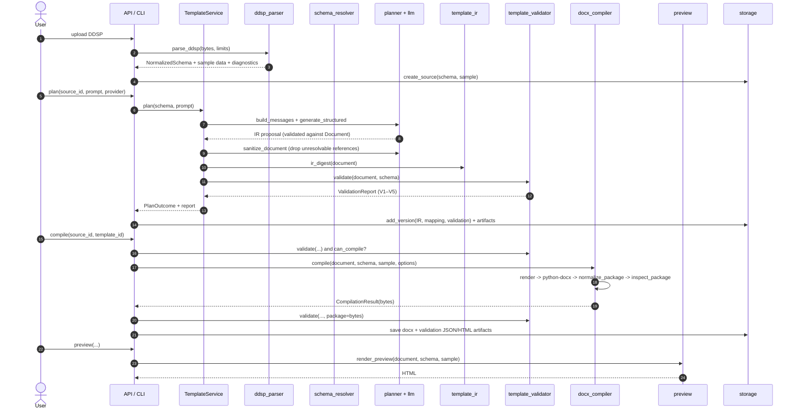

# Architecture

| Field | Value |
| --- | --- |
| System | Docentric Copilot 0.10.0 |
| Contract versions | Template IR 1.0; HTTP API `/api/v1`; CLI exit codes 0–6 |
| Related | [SRS](SRS.md), [TEMPLATE_IR](TEMPLATE_IR.md), [API_SPEC](API_SPEC.md), [ADR index](#12-adr-index) |

## 1. Architectural goals

1. **One deterministic core, several interfaces.** The HTTP API and the CLI call the same
   `TemplateService`; neither reimplements pipeline logic.
2. **A narrow AI boundary.** Only `docentric_copilot.planner` talks to a model. Since v0.11 the
   planner first decomposes the brief and retrieves a bounded, evidence-backed candidate list from
   the schema; the model chooses among those candidates, and every emitted binding is re-validated
   deterministically before the IR is accepted. Everything downstream
   of the produced IR is deterministic, offline and testable.
3. **A typed contract instead of a document diff.** Planners, compilers and validators exchange the
   Template IR, never raw OOXML or XPath.
4. **Fail closed at every trust boundary.** Untrusted bytes are parsed defensively; unsupported
   targets raise; unverified compatibility is reported as `not_tested`.
5. **Reproducibility.** The deterministic layers read no clock, perform no network I/O and use no
   randomness, so identical inputs produce identical bytes.

## 2. Layers

```text
┌────────────────────────────────────────────────────────────────────────────┐
│ Interface layer                                                            │
│   FastAPI app (api/)            Typer CLI (cli/)                           │
│   - transport validation        - argument parsing, exit codes             │
│   - HTTP status mapping         - text/JSON output                         │
│   Next.js workspace (apps/web)  - HTTP client of the API, no privileged    │
│                                   access; UI only                          │
└───────────────────────────────┬────────────────────────────────────────────┘
                                │
┌───────────────────────────────▼────────────────────────────────────────────┐
│ Application layer (app/service.py)                                         │
│   TemplateService: plan, validate, compile, revise, preview                │
│   orchestration, no transport concerns                                     │
└───────┬───────────────┬───────────────┬───────────────┬────────────────────┘
        │               │               │               │
┌───────▼──────┐ ┌──────▼───────┐ ┌─────▼───────┐ ┌─────▼───────────────┐
│ Planning     │ │ Contract     │ │ Validation  │ │ Compilation         │
│ planner/     │ │ template_ir/ │ │ template_   │ │ docx_compiler/      │
│ llm/         │ │ canonical/   │ │ validator/  │ │ package/, generic/  │
└───────┬──────┘ └──────┬───────┘ └─────┬───────┘ └─────┬───────────────┘
        │               │               │               │
┌───────▼───────────────▼───────────────▼───────────────▼────────────────────┐
│ Domain services                                                            │
│   ddsp_parser/ (untrusted input, normalized schema)                        │
│   schema_resolver/ (path resolution, candidate search, mapping)            │
│   preview/ (independent HTML rendering)                                    │
└───────────────────────────────┬────────────────────────────────────────────┘
                                │
┌───────────────────────────────▼────────────────────────────────────────────┐
│ Foundation (core/)                                                         │
│   config (env, Limits), errors (code/http/exit), ids, logging (redaction), │
│   serialization (canonical JSON, digest)                                   │
│ Infrastructure (storage/): SQLite metadata + TTL artifact files            │
└────────────────────────────────────────────────────────────────────────────┘
```

Dependency rule: arrows point downwards only. `template_ir` must not import the compiler; the
compiler may import `template_ir`. `core` imports nothing from the other layers.

## 3. Package boundaries

| Source root | Import path | Responsibility | May depend on |
| --- | --- | --- | --- |
| `packages/core` | `docentric_copilot` | Settings, `Limits`, error hierarchy, ids, logging/redaction, canonical serialization | stdlib, pydantic |
| `packages/ddsp-parser` | `docentric_copilot.ddsp_parser` | Untrusted container/XML reading, manifest, XSD mapping, schema inference, sample data | core, lxml |
| `packages/schema-resolver` | `docentric_copilot.schema_resolver` | Path grammar and resolution, alias scopes, candidate search, mapping validation | core, ddsp_parser |
| `packages/template-ir` | `docentric_copilot.template_ir` | IR models, canonical JSON, digest, migration registry, traversal | core, pydantic |
| `packages/template-validator` | `docentric_copilot.template_validator` | V1–V5 engine, report models, HTML/JSON rendering | core, ddsp_parser, schema_resolver, template_ir, docx_compiler (package inspection only) |
| `packages/docx-compiler` | `docentric_copilot.docx_compiler` | Deterministic generic DOCX compiler, package normalisation/inspection, expression evaluation, formatting, compiler registry | core, ddsp_parser, schema_resolver, template_ir, python-docx |
| `packages/llm-gateway` | `docentric_copilot.llm` | Provider adapters, structured output, retries, pricing, telemetry | core, httpx |
| `packages/planner` | `docentric_copilot.planner` | Requirement decomposition and evidence-backed candidate filtering, prompt construction, provider invocation, deterministic repair, post-generation binding review, mapping report, revisions, heuristic baseline | core, ddsp_parser, schema_resolver, template_ir, llm |
| `packages/renderer` | `docentric_copilot.preview` | Independent HTML preview | core, ddsp_parser, schema_resolver, template_ir, docx_compiler (context/expression/format) |
| `packages/evaluation` | `docentric_copilot.evaluation` | Planner quality metrics (`evaluate`, `MetricsReport`); the runner lives in `benchmarks/run_evaluation.py` | core (stdlib/pydantic) |
| `packages/reference-inspector` | `docentric_copilot.reference` | Read-only REF-00 inventory/dedup, OOXML content-control scan, REF-02 ProjectData resolver, stable report, REF-03 ReferenceGraph/projection and REF-04 diff; no execution and no AX writer | core, lxml, pydantic |
| `services/api` | `docentric_copilot.app`, `.api`, `.api.routes`, `.cli`, `.storage` | Application service, HTTP routes and schemas, CLI, SQLite + artifacts | everything above |
| `apps/web` | — | Next.js 15 single-page workspace; HTTP client of the API, build-time `NEXT_PUBLIC_API_BASE_URL`, sandboxed preview iframe | HTTP API |

The unusual layout — many source roots, one distribution — is deliberate: each directory is an
independently reviewable work package while the import namespace stays flat for users. The mapping is
declared explicitly in [pyproject.toml](../pyproject.toml) (`[tool.setuptools.package-dir]`).

## 4. Source-root-to-SOW-package mapping

"SOW package" here means a work package with its own directory, owner and review surface. The table is
the normative ownership map.

| SOW package | Directory | Namespace | Key entry points |
| --- | --- | --- | --- |
| SOW-00 Foundation | `packages/core` | `docentric_copilot` | `get_settings`, `CopilotError`, `canonical_json`, `digest`, `redact` |
| SOW-01 DDSP ingestion | `packages/ddsp-parser` | `docentric_copilot.ddsp_parser` | `parse_ddsp`, `parse_xml`, `build_sections_from_xsd`, `NormalizedSchema` |
| SOW-02 Schema resolution | `packages/schema-resolver` | `docentric_copilot.schema_resolver` | `resolve_value`, `resolve_collection`, `search_candidates`, `validate_mapping` |
| SOW-03 Template IR | `packages/template-ir` | `docentric_copilot.template_ir` | `Document`, `load_document`, `ir_digest`, `document_json_schema`, `migrate` |
| SOW-04 Validation | `packages/template-validator` | `docentric_copilot.template_validator` | `ValidationEngine.validate`, `ValidationReport`, `render_report_html` |
| SOW-05 Compilation | `packages/docx-compiler` | `docentric_copilot.docx_compiler` | `GenericDocxCompiler.compile`, `compile_document`, `inspect_package`, `DocentricAXCompiler` |
| SOW-06 LLM gateway | `packages/llm-gateway` | `docentric_copilot.llm` | `LLMGateway.generate_structured`, `MockProvider`, `price_for` |
| SOW-07 Planning | `packages/planner` | `docentric_copilot.planner` | `TemplatePlanner.plan`, `build_document` (baseline), `sanitize_document`, `diff_documents` |
| SOW-08 Preview | `packages/renderer` | `docentric_copilot.preview` | `render_preview` |
| SOW-09 Evaluation | `packages/evaluation` | `docentric_copilot.evaluation` | `EvaluationCase`, `evaluate`, `MetricsReport`, `MetricValue` |
| SOW-10 Application service | `services/api/src/docentric_copilot/app` | `docentric_copilot.app` | `TemplateService` |
| SOW-11 HTTP API | `services/api/src/docentric_copilot/api` | `docentric_copilot.api` | `create_app`, route modules, `schemas` |
| SOW-12 CLI | `services/api/src/docentric_copilot/cli` | `docentric_copilot.cli` | `app`, commands in `main.py` |
| SOW-13 Storage | `services/api/src/docentric_copilot/storage` | `docentric_copilot.storage` | `Store`, `SourceRecord`, `VersionRecord`, `ArtifactRecord` |
| SOW-14 Examples/tooling | `scripts`, `examples` | — | `build_examples.py`, synthetic packages |
| SOW-15 Web frontend | `apps/web` | — | Delivered: Next.js 15 workspace (`npm run build`), API client, workspace panels |
| SOW-16 Reference inspection | `packages/reference-inspector` | `docentric_copilot.reference` | `inspect_reference`, `scan_docx`, `load_project_data`, `resolve_controls`, `ReferenceReport`, `build_reference_graph`, `build_reference_diff` |
| SOW-17 Reference evaluation | `benchmarks` | — | `reference_evaluation.py`, `reference_cases.json`, synthetic REF-05 fixtures |

## 5. Data flow



### 5.1 Parsing (DDSP → normalized schema)

1. `check_file_size` enforces the global byte limit.
2. `classify_container` chooses ZIP vs single XML vs rejection.
3. For ZIP: `read_container` enforces entry count, name safety, encryption, nested archives, declared
   and actual uncompressed size, per-entry compression ratio, and CRC/decompression errors.
4. `_load_manifest` reads the first recognised manifest (≤ 64 KiB, object, allow-listed keys).
5. `_prioritise` analyses entries whose names hint at sample data first, then the rest, capped at 40
   XML documents.
6. Each XML document is parsed with DTD/entity/network disabled and node/depth limits enforced. The
   first XSD-like document wins; otherwise the first data document is used for inference.
7. `build_sections_from_xsd` or `infer_sections_from_sample` produces `SchemaSection`/`SchemaNode`
   trees. `NormalizedSchema` indexes every path for O(1) lookup and exposes a digest that excludes
   diagnostics.

### 5.2 Planning (schema + requirement → IR)

1. `extract_requirements` splits the prompt into at most 12 reviewable clauses.
2. `build_messages` assembles a system prompt and a user message with fenced `<requirement>` and
   `<schema>` sections. Only paths, types, collection flags and required flags are included — never
   sample values.
3. The gateway calls the selected provider with the Template IR JSON Schema; the response is validated
   against `Document` before use.
4. `sanitize_document` walks the IR with lexical alias scopes and drops every binding, repeat,
   conditional or image that cannot be resolved. Removals are recorded, not replaced.
5. `build_mapping_report` derives `resolved/ambiguous/missing/invalid` per clause from the accepted IR.
6. Validation runs on the sanitized document (without sample data, so V4 is `skipped`).

### 5.3 Compilation (IR → DOCX)

1. The compiler refuses a non-generic target unless `verified_compatibility` is true (it is false for
   the AX placeholder).
2. `_Renderer` builds a `python-docx` document: page settings, fixed core properties, header/footer of
   the first section, then body blocks with alias-aware sample context.
3. `normalize_package` rewrites the ZIP: sorted entries, fixed timestamps, fixed permissions,
   deterministic deflate level.
4. `inspect_package` checks required entries and forbidden markers; failure raises
   `CompilationFailedError` rather than returning an unsafe file.
5. The result carries the IR digest, statistics, warnings and `compatibility="not_tested"`.

### 5.4 Validation

The engine flattens the IR once (`_walk`) recording the alias scope valid at each block, then runs
V1 structural, V2 semantic, V3 logical, V4 visual (optional sample data) and V5 compatibility. Reports
are immutable pydantic models; `statuses()`, `can_compile` and `overall` are derived views.

### 5.5 Artifacts and storage

SQLite tables: `sources`, `templates`, `versions`, `jobs`, `artifacts`. Artifact bytes live in
`DC_DATA_DIR/artifacts/{artifact_id}{extension}`; rows carry media type, SHA-256 digest, size and
`expires_at`. `get_artifact` deletes and rejects expired rows (`410`); `purge_expired` runs at startup.

## 6. Determinism strategy

Determinism is a property of the parse → plan(mock) → validate → compile chain, not of hosted models.

| Source of nondeterminism | Control | Code |
| --- | --- | --- |
| ZIP entry order | Entries sorted by name | `docx_compiler/package.py` |
| ZIP timestamps | Fixed `2024-01-01T00:00:00` | same |
| ZIP permissions / compression | Fixed `0644`, deflate level 9 | same |
| DOCX core properties | Fixed created/modified/revision/author; values derived from IR | `docx_compiler/generic.py` |
| Clock | No `datetime.now()` / `time.time()` on compile paths; fixed `FIXED_DATETIME` | same |
| Randomness | No `random`/`uuid` in the deterministic layers; ids are only for storage | `core/ids.py` |
| Dict ordering | Canonical JSON sorts keys; traversal sorts where order matters | `core/serialization.py` |
| XML parser | `recover=False`, comments/PIs removed, stable section selection | `ddsp_parser/safety.py` |
| Provider | Not deterministic; output is sanitized and validated as untrusted input | `planner/service.py` |
| Example packages | Generator uses fixed timestamps and sorted entries | `scripts/build_examples.py` |

Digests: the IR digest is SHA-256 over canonical JSON of the document (all fields, including nulls).
Schema digests exclude diagnostics. Artifact digests are SHA-256 of the stored bytes. None of these is
a signature.

## 7. Error model

Every expected failure derives from `CopilotError` and carries `code`, `http_status`, `exit_code`,
`message` and optional `details`. The API returns:

```json
{"error": {"code": "target_unsupported", "message": "...", "details": {"target": "docentric-ax"}}}
```

| Error class | `code` | HTTP | CLI exit |
| --- | --- | --- | --- |
| `InvalidInputError` | `input_invalid` | 400 | 3 |
| `SecurityViolationError` | `security_violation` | 400 | 3 |
| `UnsupportedInputError` | `input_unsupported` | 415 | 3 |
| `ValidationFailedError` | `validation_failed` | 422 | 1 |
| `CompilationFailedError` | `compilation_failed` | 422 | 1 |
| `UnsupportedTargetError` | `target_unsupported` | 409 | 4 |
| `ProviderError` | `provider_error` | 502 | 5 |
| `ProviderNotConfiguredError` | `provider_not_configured` | 503 | 5 |
| `BudgetExceededError` | `budget_exceeded` | 402 | 5 |
| `NotFoundError` | `not_found` | 404 | 6 |
| `ArtifactError` | `artifact_unavailable` | 410 | 6 |
| Unexpected exception | `internal_error` | 500 | — |

FastAPI request-model failures are converted to `422 input_invalid` with per-field details; an
unhandled exception is logged with a traceback and returned as `500 internal_error` without details.

## 8. Concurrency and process model

- One process, one SQLite connection, one `threading.Lock` around every database operation.
- CPU-bound validation/compilation and preview rendering run in Starlette's threadpool; parsing runs
  in the request coroutine.
- `TemplateService` is created once per application instance and shares an `LLMGateway`; HTTP clients
  are created per request unless a transport is injected (tests).
- The service is not designed for multiple writers or horizontal scaling; see
  [NFR-08](SRS.md#nfr-08--concurrency-and-scalability).

## 9. Security boundaries

| Boundary | Control |
| --- | --- |
| Untrusted DDSP → parser | Limits, container validation, DTD/entity/network disabled |
| Untrusted requirement → model | Data fences, system-prompt rule that fenced content is data |
| Model output → IR | JSON Schema validation, `extra="forbid"`, deterministic sanitisation |
| IR → OOXML | No raw OOXML in the IR; compiler emits fixed constructs only; package inspection |
| Artifacts → browser | `nosniff`, `no-store`, restrictive CSP for preview, HTML view limited to HTML artifacts |
| Secrets → logs/API | Allow-listed settings view, redaction formatter, no message content logged |

Details and residual risks: [THREAT_MODEL.md](THREAT_MODEL.md).

## 10. Extension points

| Extension | Where | Constraint |
| --- | --- | --- |
| New LLM provider | `llm/providers.py` + `config._build_providers` | Must return a JSON object; no provider-specific types may leak past the gateway |
| New compiler target | `docx_compiler/registry.py` | Must declare `verified_compatibility` honestly; unverified targets must raise |
| New IR version | `template_ir/canonical.py` `MIGRATIONS` | Add a one-step migration and update `IR_SCHEMA_VERSION` |
| New XSD construct | `ddsp_parser/xsd.py` | Unsupported constructs must degrade with a diagnostic, never be guessed |
| New diagnostic | `ddsp_parser/diagnostics.py` | Codes are a public contract; never reuse or renumber |
| New validation check | `template_validator/engine.py` | New code in the `V1-…`–`V5-…` namespace; update [TEMPLATE_IR.md](TEMPLATE_IR.md) and SRS |
| New block kind | `template_ir/models.py` + compiler + preview + validator | Requires an IR version decision because `extra="forbid"` makes old readers reject it |
| New API endpoint | `api/routes/` + `api/schemas.py` | Must use the error envelope and document the status codes |

## 11. Known architectural constraints and debt

1. **The document model is not a paginator.** `python-docx` writes OOXML; layout is decided by the
   consumer (Word, LibreOffice, a renderer). V4 cannot check real layout.
2. **The IR is the only contract.** Anything not expressible in the IR (footnotes, fields, content
   controls, tracked changes) cannot be generated. This is intentional for the MVP.
3. **The preview duplicates rendering logic** rather than sharing a document object model. It reuses
   context resolution, expression evaluation and formatting, but layout code is separate, so the two
   can drift; tests cover shared semantics only.
4. **Secondary sections are flattened.** Multiple IR sections become page breaks in a single Word
   section; their headers/footers are not rendered and produce a warning.
5. **Single-process persistence.** SQLite and local files are deliberate MVP shortcuts, not a service
   architecture.
6. **Evaluation accounting.** The evaluation harness computes field precision/recall from bindings it
   can resolve; alias-resolved table bindings are currently not counted, which understates recall on
   the shipped fixtures. See [EVALUATION](EVALUATION.md).
7. **The frontend is a plain HTTP client.** `apps/web` has no privileged access: it renders API
   responses, displays previews in a sandboxed iframe (`sandbox=""`) and downloads artifacts through
   the API. Its API base URL is baked at build time, so one build targets one API origin; there is no
   runtime configuration endpoint and no server-side session. No browser E2E suite is committed.

## 12. ADR index

| ADR | Decision |
| --- | --- |
| [0001](adr/0001-template-ir.md) | Use a typed, versioned Template IR instead of direct DOCX generation |
| [0002](adr/0002-llm-compiler-separation.md) | Separate LLM planning from deterministic compilation |
| [0003](adr/0003-deterministic-docx.md) | Make DOCX output byte-deterministic |
| [0004](adr/0004-preview-strategy.md) | Independent HTML preview, not a layout emulator |
| [0005](adr/0005-docentric-compatibility-gate.md) | Gate Docentric AX compatibility behind an evidence gate |
| [0006](adr/0006-provider-gateway.md) | One provider gateway with a shared structured-output contract |
