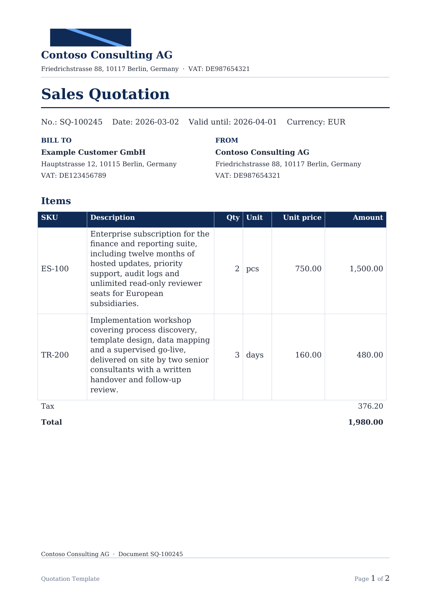
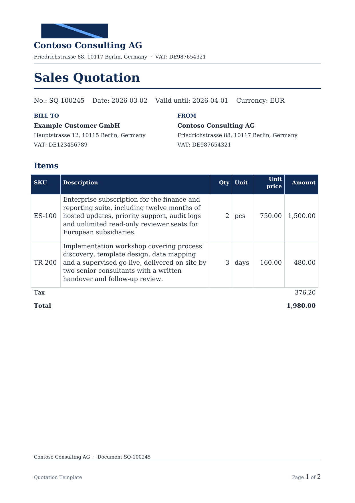

# LibreOffice rendering evidence

Status: **optional, labelled evidence.** The default API image and the CI build do not include
LibreOffice. This page describes the optional `api-pdf` Docker target, the `scripts/docx_to_pdf.py`
helper, and the two recorded page images in [assets](assets/).

Everything produced this way is **LibreOffice rendering**. It is not a Microsoft Word fidelity proof
and not a Docentric AX rendering proof.

## What the rendering proves

- A real consumer opens the compiled DOCX without an OOXML repair prompt and produces a PDF.
- The page count and the rendered table split can be observed instead of inferred from the IR.
- Text actually wraps in the cells; a long description visibly occupies more lines than a short one.
- A before/after pair shows whether the typed layout changes (column width, table font size) survive
  compilation and change what a renderer draws.
- The table stays inside the text area; an overflow would be visible as a column crossing the margin.

## What it does not prove

- **Not Word fidelity.** Word and LibreOffice use different line-breaking, font substitution and
  pagination engines. A page count or a break position can differ in Word.
- **Not Docentric AX fidelity.** The AX compatibility status remains `not_tested`; see
  [DOCENTRIC_AX_COMPATIBILITY.md](DOCENTRIC_AX_COMPATIBILITY.md).
- **Not deterministic evidence.** LibreOffice and font versions affect output. The PDFs and PNGs are
  illustrative artifacts, not golden files in the test suite.
- **Not a layout guarantee for arbitrary machines.** A viewer without the expected fonts may wrap
  the same DOCX differently.
- **Not the HTML preview.** The product preview is a separate, independent rendering; its layout
  already differs from Word/Docentric pagination and is not the subject of these images.

## Build and run

Build the optional target. It starts from the normal API image and adds `libreoffice-writer`,
`libreoffice-core`, `fonts-dejavu` and `poppler-utils`:

```bash
docker build --target api-pdf -t docentric-copilot-api-pdf .
```

Convert a DOCX and rasterise page 1 at 150 dpi:

```bash
mkdir -p .render
docker run --rm --user "$(id -u):$(id -g)" \
  -v "$PWD:/work" -w /work docentric-copilot-api-pdf \
  python scripts/docx_to_pdf.py .render/quotation.docx \
    --png .render/quotation-page1.png --dpi 150
```

On a workstation that already has LibreOffice and poppler installed, the same script runs directly:

```bash
python scripts/docx_to_pdf.py document.docx -o document.pdf --png page1.png --dpi 150
python scripts/docx_to_pdf.py document.docx --png-dir pages/ --dpi 150
```

The script calls `soffice --headless --convert-to pdf` with a temporary LibreOffice profile, then
`pdftoppm` for the PNG. It exits with code 2 and a clear message when `soffice` or `pdftoppm` is
missing. `--help` lists all options.

The target is not built by `docker compose up`, the default `docker build .` or the CI Docker job:
the final stage remains the slim `runtime` image, and `api-pdf` is reached only with `--target`.

## Recorded evidence

The evidence below was produced from the bundled `quotation-long-items` demo package, compiled to
DOCX before and after `POST /api/v1/templates/optimize`. Both images are **full page 1 at 150 dpi**
(1241 x 1754 px), rasterised from the PDF written by LibreOffice Writer 25.2 and `pdftoppm`.

### Before optimisation



The Description column is 62 mm at 9.5 pt. Both item descriptions visibly wrap over many lines; the
IR quality report has one `text_fit` warning covering two table cells (estimated at seven lines).

### After optimisation



Optimisation widened Description from 62.0 mm to 88.7 mm by rebalancing SKU, Qty, Unit, Unit price
and Amount, then lowered the table font from 9.5 pt to 9.0 pt. The same text now uses fewer lines
(about five in this rendering), the table still fits the 170 mm text area, and `text_fit` passes. The
document remains two pages in this rendering; the evidence here is the table wrap, not a page-count
claim.

Reproduce the pair by compiling the demo package before and after optimisation and running the
commands above. See [DOCX_OPENING.md](DOCX_OPENING.md) for where the artifact comes from and how to
open it.

## Full-document visual regression (P1)

`scripts/visual_regression.py` turns the single-image evidence above into a
repeatable before/after regression over **every page**:

```bash
python scripts/visual_regression.py \
  --cases benchmarks/visual_cases.json \
  --output docs/media/visual \
  --image docentric-copilot-api-pdf:local
```

For each case it plans the template with the deterministic mock baseline,
compiles DOCX **before** and **after** `optimize_layout`, renders both through
`scripts/docx_to_pdf.py` inside the `api-pdf` image, and rasterises every page.
The image is built from the `api-pdf` Docker target when it is missing. Page
images are downscaled to 1100 px width and saved as 32-colour PNGs; the four
committed cases total under 3 MB.

### Checks

| Check | Method | Honest limit |
| --- | --- | --- |
| Blank page | pixel ink fraction and variance | a header/footer makes a page non-blank |
| Horizontal overflow | ink outside `margin_left`/`margin_right` plus 1.5 mm tolerance | 5 mm warning band absorbs LibreOffice table-border overhang |
| Page-edge ink | ink within 2 mm of a page edge | catches gross vertical overflow only |
| Page count change | before/after page counts | a change is a warning, not proof of content loss |
| Header/footer text | `pdftotext -bbox-layout`, top/bottom 18% bands | band heuristic, not Word layout |
| Footer page number | `pdftotext`, regex `Page N of M` | the compiler adds it on every page |
| `text_fit` | IR quality analysis before/after | deterministic estimate, not measured wrapping |
| Vertical body overflow | — | **`not_checked`**: headers/footers occupy the margins |

`not_checked` is a first-class status. The summary reports
`checked_checks`, `not_checked_count`, unresolved warnings per type and
`new_critical_defects`; `all_checks_passed` is false while any check is
`not_checked`. A global status of `passed` therefore never claims that every
possible check was performed.

### Committed cases

| Case | Family | Before → after pages | Status | Observations |
| --- | --- | --- | --- | --- |
| [quotation-long-items](media/visual/quotation-long-items/report.html) | long descriptions | 2 → 2 | warning | `text_fit` warning became passed; one ~1.7 mm table-border overhang remains in the warning band |
| [quotation-40-rows](media/visual/quotation-40-rows/report.html) | multi-page table | 8 → 7 | warning | repeated header on every page; smaller font reduced the page count by one; one page position exists only before |
| [quotation-empty-lines](media/visual/quotation-empty-lines/report.html) | empty collection | 2 → 2 | passed (2 not checked) | no phantom rows; vertical overflow is `not_checked` |
| [quotation-conditional](media/visual/quotation-conditional/report.html) | conditional block | 2 → 2 | warning | EU VAT notice renders; the same table-border warning applies |

Aggregate reports: [summary.html](media/visual/summary.html) and
[summary.json](media/visual/summary.json). The committed run reports zero new
critical defects; the unresolved warnings are table-border overhang on table
pages and the 40-row page-count change. The HTML reports link every before/after
page image and list each check with its status and reason.

The fixtures are regenerated deterministically by
`python benchmarks/build_visual_fixtures.py`; `--check` verifies the committed
bytes. The cases are declared in
[benchmarks/visual_cases.json](../benchmarks/visual_cases.json).
