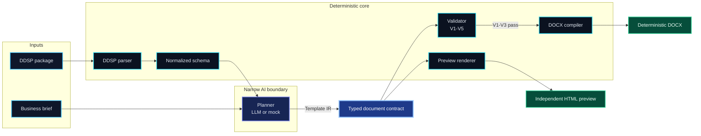
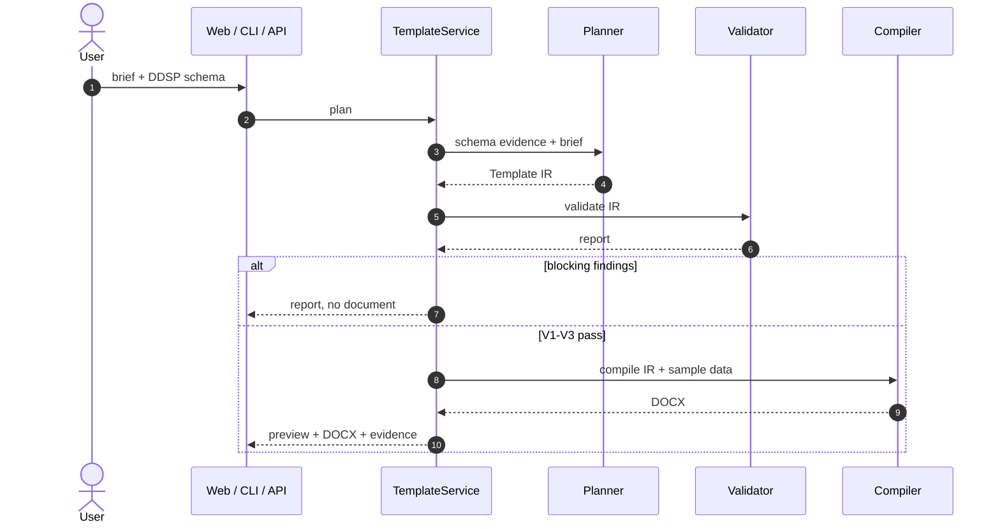
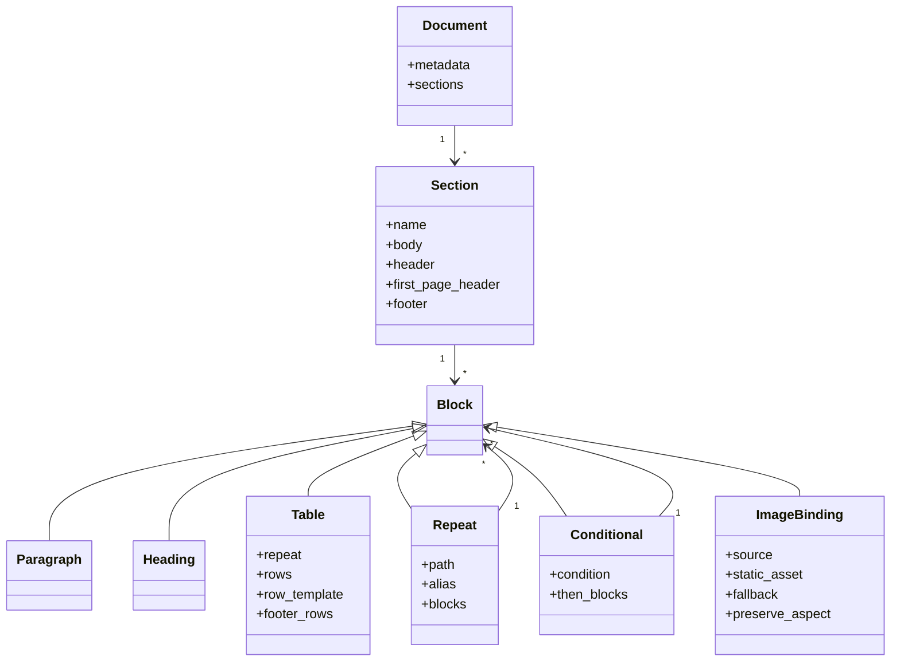
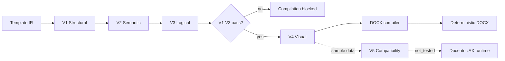
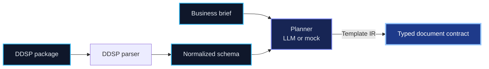
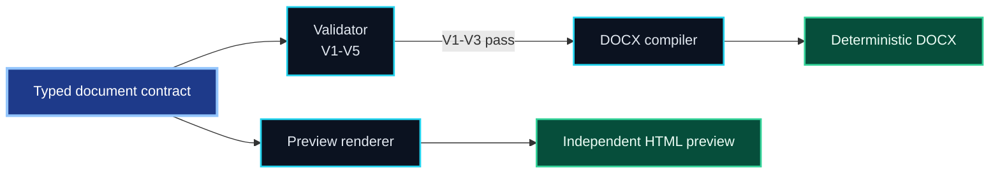
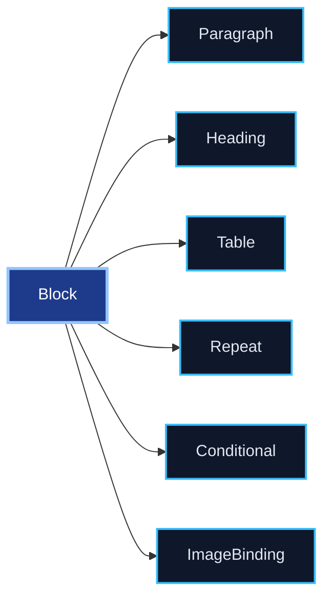
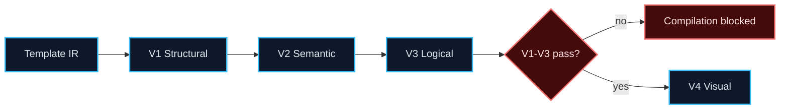
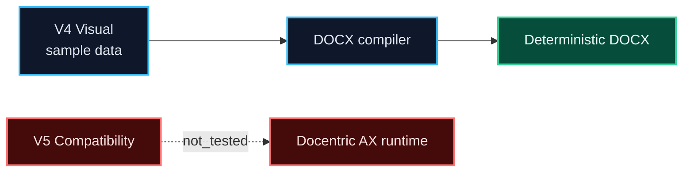
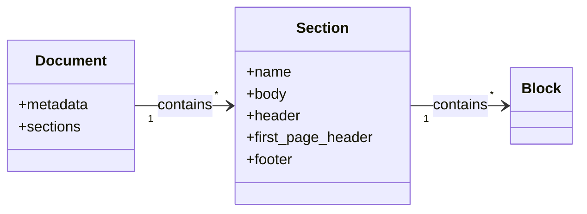

# Architecture

> One deterministic core, three interfaces, and a narrow AI boundary.

## Layers

```text
┌───────────────────────────────────────────────────────────────────────┐
│ Interfaces        Next.js workspace · CLI (Typer) · REST API (FastAPI) │
├───────────────────────────────────────────────────────────────────────┤
│ Application       TemplateService: plan · validate · compile · revise  │
├───────────────────────────────────────────────────────────────────────┤
│ Planning          prompt assembly · LLM gateway · mock baseline        │
├───────────────────────────────────────────────────────────────────────┤
│ Contract          Template IR v1.0 · canonical JSON · digest · JSON Schema │
├───────────────────────────────────────────────────────────────────────┤
│ Execution         validator V1–V5 · deterministic DOCX compiler    │
├───────────────────────────────────────────────────────────────────────┤
│ Domain services   DDSP parser · schema resolver · preview renderer    │
├───────────────────────────────────────────────────────────────────────┤
│ Foundation        config · errors · ids · redacted logging · storage   │
└───────────────────────────────────────────────────────────────────────┘
```

**Dependency rule:** arrows point downwards only. `template_ir` never imports the compiler; the compiler may
import `template_ir`. `core` imports nothing from the layers above it.

## Data flow



The same data flow is rendered for the Technical Deep-Dive video from this
Wiki page by `scripts/render_wiki_diagrams.py`; the video and this diagram must
not diverge.

## Request lifecycle



## Package map

| Path | Responsibility |
| --- | --- |
| `packages/ddsp-parser` | Untrusted ZIP/XML ingestion, XSD→schema, sample data, diagnostics |
| `packages/schema-resolver` | Path resolution, alias scopes, candidate search, mapping models |
| `packages/template-ir` | Typed IR, canonical serialization, digest, JSON Schema, traversal |
| `packages/template-validator` | V1–V5 checks and report rendering |
| `packages/docx-compiler` | Deterministic DOCX generation and package normalization |
| `packages/llm-gateway` | Provider contract, OpenAI/Anthropic/Gemini adapters, mock provider |
| `packages/planner` | Prompt construction, baseline planner, repair pass, revisions |
| `packages/renderer` | Independent HTML preview |
| `packages/evaluation` | Metric definitions and evaluation harness |
| `services/api` | FastAPI app, CLI, SQLite storage and artifact store |

## Determinism strategy

| Source of non-determinism | Treatment |
| --- | --- |
| Wall-clock timestamps | Fixed document properties; ZIP entries rewritten with a fixed timestamp |
| ZIP entry order | Sorted on export |
| Random identifiers | Stable relationship ids; no random content inside the package |
| Model temperature | `temperature = 0` by default; the mock planner is fully deterministic |
| Locale | English number/date formatting in the MVP, documented as a limitation |

Verified by a byte-equality test in the compiler suite and by the golden-file corpus.

## Failure philosophy

Every trust boundary fails closed:

| Boundary | Failure behaviour |
| --- | --- |
| Upload | size/entry/ratio/depth limits → structured error |
| XML | DTD/entity declarations rejected (`XML001`), no network, no recovery parsing |
| Planning | unknown fields removed and reported; invalid output triggers a bounded repair attempt |
| Validation | V1–V3 failure blocks compilation |
| Compilation | unknown target → HTTP 409 / exit 4, never a partial document |
| Artifacts | TTL, path validation, digest header, no inline execution |

## Storage

SQLite (metadata: sources, templates, versions, jobs, artifacts) plus a file store for artifacts. Sources and
artifacts expire after a TTL; template versions and job records are retained until the database is removed.

## Extension points

| Want to add… | Touch |
| --- | --- |
| A new block kind | `template_ir/models.py`, validator, compiler, preview |
| A new provider | `llm-gateway/providers.py` + gateway registration |
| A new data format | `ddsp-parser` with a new normalizer, keep `NormalizedSchema` stable |
| A new validation level | `template_validator/engine.py` + report model |
| A new output target | a compiler implementing the `compile()` contract, gated like the AX adapter |

Deeper rationale lives in the ADRs: [0001 Template IR](https://github.com/SergeyGer/Docentric-Copilot/blob/main/docs/adr/0001-template-ir.md),
[0002 LLM/compiler separation](https://github.com/SergeyGer/Docentric-Copilot/blob/main/docs/adr/0002-llm-compiler-separation.md),
[0003 Deterministic DOCX](https://github.com/SergeyGer/Docentric-Copilot/blob/main/docs/adr/0003-deterministic-docx.md),
[0004 Preview strategy](https://github.com/SergeyGer/Docentric-Copilot/blob/main/docs/adr/0004-preview-strategy.md),
[0005 Compatibility gate](https://github.com/SergeyGer/Docentric-Copilot/blob/main/docs/adr/0005-docentric-compatibility-gate.md),
[0006 Provider gateway](https://github.com/SergeyGer/Docentric-Copilot/blob/main/docs/adr/0006-provider-gateway.md).

## Template IR contract



## Validation ladder



V1–V3 block compilation. V4 is visual/layout validation and may be skipped
without sample data. V5 is the Docentric AX compatibility gate and remains
`not_tested`; it is not a generic Word compatibility claim.

## Focused views used in the walkthrough

The data-flow diagram is deliberately repeated as two focused views so a
narration can zoom into planning and compilation without cutting labels. These
views are derived from the same graph above.












