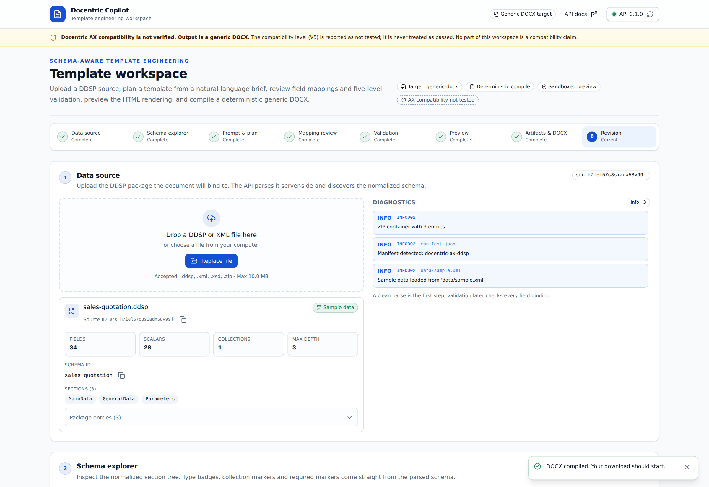
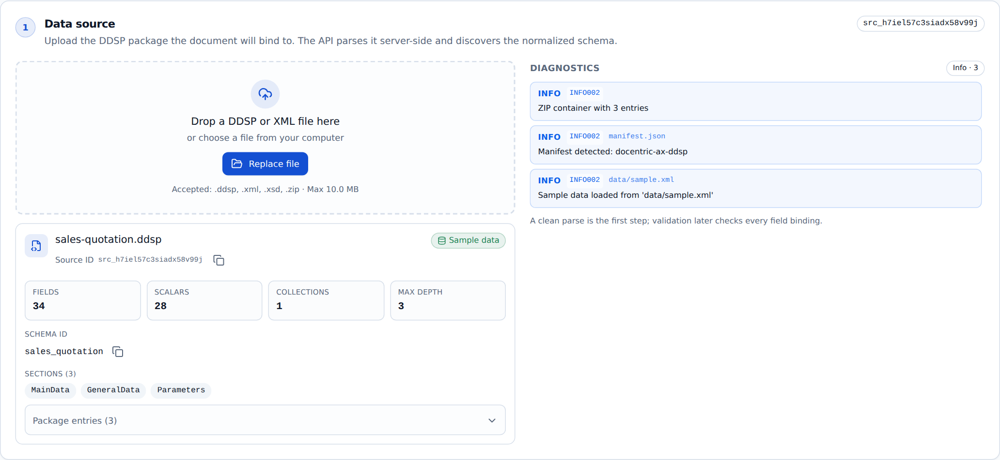
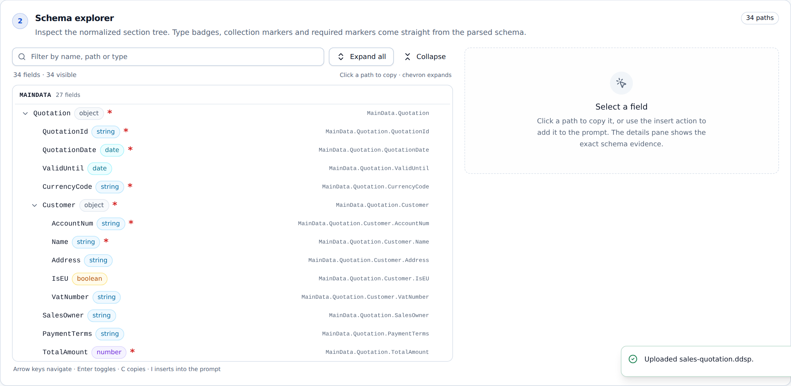
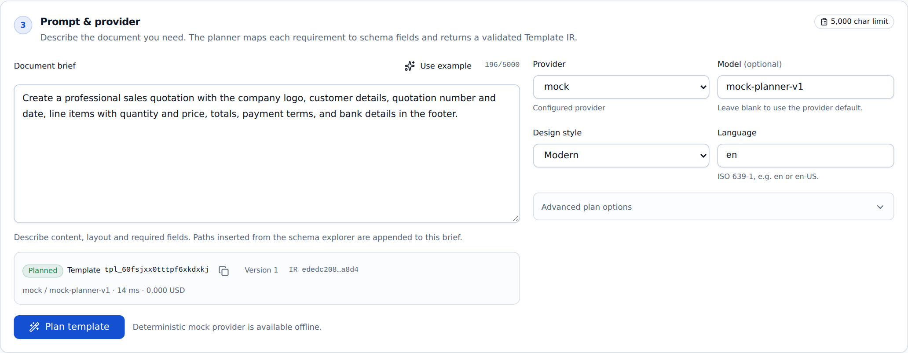
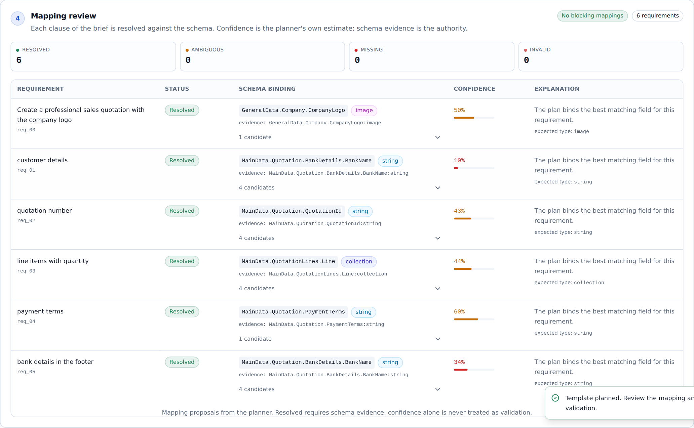
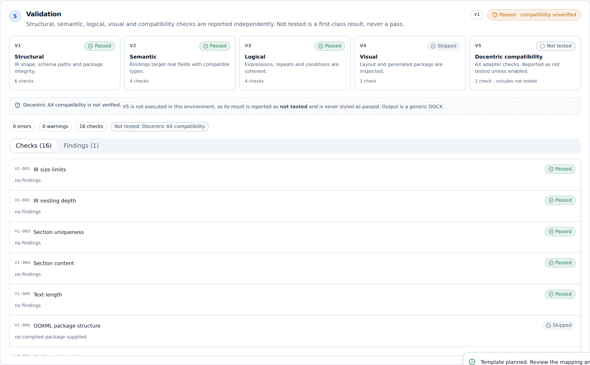
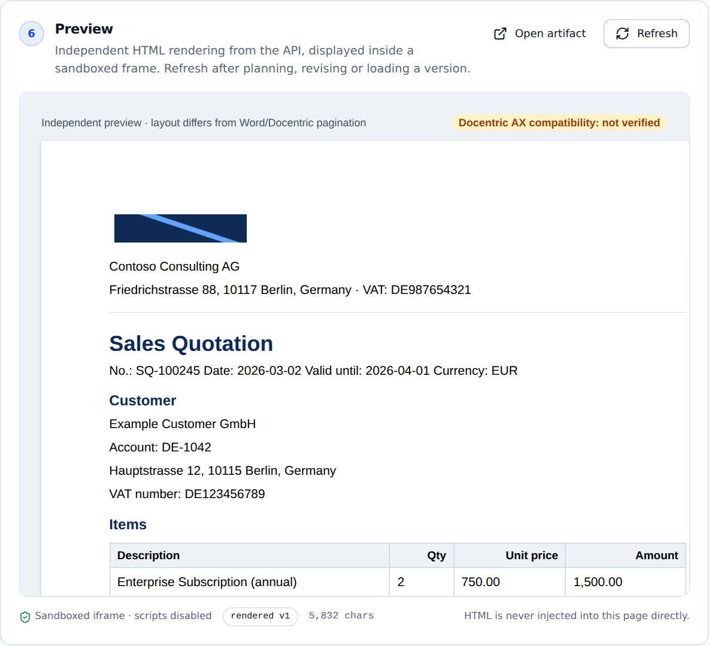
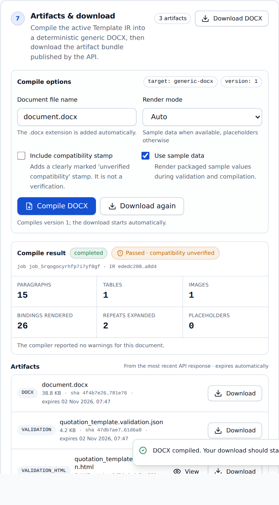
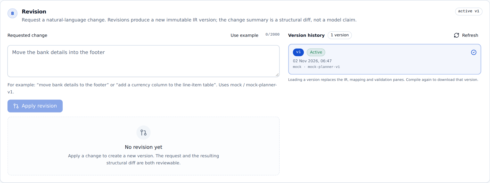

# Feature Tour

> A walkthrough of the web workspace, panel by panel. Every screenshot comes from a real run on the
> synthetic quotation example.

The workspace follows the natural order of the work: **source → schema → brief → mapping → validation →
preview → download → revision**. The stepper at the top turns green as each stage completes.

---

## 1. Data source

Upload a DDSP package (or a plain XML/XSD file). The API parses it server-side and returns:

- schema id, sections and field counts (**34 fields · 28 scalars · 1 collection · depth 3** for the example);
- a **diagnostics feed** with severity, stable codes and the exact location inside the package;
- a flag telling you whether sample data is available for preview.

A clean parse is the first line of defence: if the file is corrupt, hostile or unsupported, the panel says
so before any model is involved.

---

## 2. Schema explorer

The normalized schema is the source of truth for every binding.

| Capability | Detail |
| --- | --- |
| Type badges | `string`, `number`, `boolean`, `date`, `image`, `collection`, `object` |
| Markers | `required`, collection (`[]`), inherited depth |
| Search | filter by path or type |
| Keyboard | `↑`/`↓` move, `→` expand, `←` collapse, `Enter` select, `C` copy path, `I` insert into brief |
| Evidence | selecting a field shows its full path, type and where it came from |

Paths inserted from the explorer are appended to the brief, so a non-technical author can point at a field
without knowing the schema syntax.

---

## 3. Prompt & provider

Write the requirement the way you would explain it to a colleague. Choose a provider and, optionally, a
model. Design style and language affect the generated layout and document metadata.

The panel also exposes **advanced plan options**: strict validation (reject a plan that fails V1–V3), a cost
cap in USD, and the number of automatic repair attempts.

`mock` is always available and produces deterministic output offline — ideal for demos, tests and CI.

---

## 4. Mapping review

Every clause of the brief becomes a row:

| Column | Meaning |
| --- | --- |
| **Requirement** | The clause extracted from your brief |
| **Status** | `resolved` · `ambiguous` · `missing` · `invalid` |
| **Schema evidence** | The field actually bound, with its type |
| **Candidates** | Alternatives the engine considered |
| **Confidence** | The planner's own estimate — never treated as proof |
| **Explanation** | Why this decision was made |

This is the heart of the product: a reviewer can see exactly what the AI decided, and why, before any
document exists.

---

## 5. Validation

Five levels, reported independently:

| Level | Checks | Typical result |
| --- | --- | --- |
| **V1 Structural** | IR shape, limits, section uniqueness, OOXML package | `passed` |
| **V2 Semantic** | every binding exists and has a compatible type | `passed` |
| **V3 Logical** | repeats iterate collections, conditions are type-correct | `passed` |
| **V4 Visual** | layout fits the page (requires sample data) | `passed` / `skipped` |
| **V5 Compatibility** | execution inside a licensed Docentric AX environment | **`not_tested`** |

`not_tested` is rendered with a dashed neutral badge, never green. Details: [Validation Model](Validation-Model).

---

## 6. Preview

A sandboxed HTML rendering of the plan with the source's sample data: logo, header, customer block, item
table, totals, conditional notice and footer.

The preview is explicitly **not** a Word or Docentric layout simulation — pagination and font substitution
will differ. It exists to review *content and bindings*, quickly.

---

## 7. Artifacts & download

One click compiles the generic DOCX and publishes the artifact bundle:

- `document.docx` — the compiled document;
- `*.ir.json` — the canonical Template IR that produced it;
- `*.mapping.json` — the requirement-to-field report;
- `*.validation.json` / `*.validation.html` — machine and human readable validation;
- `*.preview.html` — the rendered preview.

Artifacts expire after a configurable TTL (one hour by default) and are served with a SHA-256 digest header.

---

## 8. Revision

Request a change in natural language — *“move the bank details to the footer and make the table compact”*.
The system produces a **new IR version**, shows a structural diff (added / removed / changed), and keeps the
previous version loadable. Documents are never edited in place.

---

## Also included

- **CLI parity** — every workspace action exists as a command, with stable exit codes.
- **Deterministic output** — identical input produces identical bytes, verified in tests.
- **Accessibility** — keyboard operation, labelled controls, visible focus, no colour-only status.
- **Honest UI** — the amber banner about unverified compatibility is always visible and cannot be dismissed.
