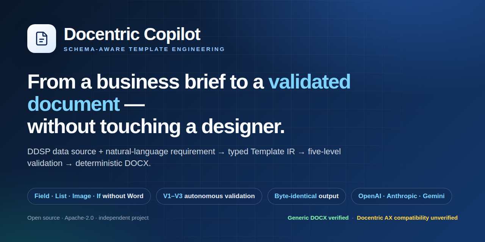
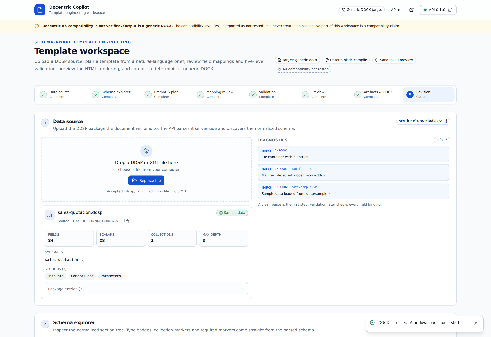

> **Live demo:** [https://docentric-copilot-bqpx8652tmmliwk9c2d5rq.streamlit.app](https://docentric-copilot-bqpx8652tmmliwk9c2d5rq.streamlit.app) — click through the full pipeline without an API key.


# Welcome to the Docentric Copilot Wiki

**Schema-aware template engineering for enterprise documents.**

Docentric Copilot turns two simple inputs — a **data source package** and a **plain-language brief** — into a
professionally structured Word document, with a reviewable plan and a machine-checked validation report.

No Microsoft Word. No template designer session. No Dynamics 365 environment.

> **Status:** v0.12.0 released. The engine produces **generic DOCX** documents and proves every binding
> against the data source. Docentric AX compatibility is **unverified** and reported as `not_tested`
> everywhere — see [Honest Status](Honest-Status) and [Docentric AX Compatibility](Docentric-AX-Compatibility).

---

## What happens in one run

```text
  Business brief            Data source                Reviewable plan            Final document
  ─────────────             ───────────                ───────────────            ──────────────
  "Create a sales    +    SalesQuotation.ddsp   →   Template IR + mapping   →   quotation.docx
   quotation with…"                                  + validation report        (deterministic)
```

1. **Drop in a DDSP** — the tool reads the data contract and shows every available field, type and collection.
2. **Describe the document** — “quote with logo, customer block, item table, totals, VAT notice and bank details”.
3. **Review the plan** — each requirement is linked to a real field, with candidates, confidence and schema evidence.
4. **Check the result** — five independent validation levels, from structure to compatibility.
5. **Download** — DOCX, Template IR (JSON), mapping report and validation report.



---

## Three promises

| Promise | What it means in practice |
| --- | --- |
| **Correctness over plausibility** | A field that does not exist in the data source can never appear in a document. The engine fails closed instead of guessing. |
| **Deterministic output** | The same plan, data and compiler version produce a byte-identical DOCX. Documents become testable artefacts. |
| **Honest compatibility** | Generic DOCX is delivered today. Docentric AX output is gated behind an independent verification that has not been performed. |

---

## Where to go next

| If you want to… | Start here |
| --- | --- |
| See it working in five minutes | [Quick Start](Quick-Start) |
| Understand the value before the details | [Why Docentric Copilot](Why-Docentric-Copilot) |
| Walk through every screen | [Feature Tour](Feature-Tour) |
| Use the CLI or the REST API | [CLI Reference](CLI-Reference) · [API Reference](API-Reference) |
| Understand the contract behind a template | [Template IR](Template-IR) · [Validation Model](Validation-Model) |
| Judge the engineering | [Architecture](Architecture) · [Testing](Testing) · [Benchmarks & Evaluation](Benchmarks-and-Evaluation) |
| Read the maintained, honest status | [Honest Status](Honest-Status) · [Roadmap](Roadmap) |
| Assess risk or report a vulnerability | [Security & Threat Model](Security-and-Threat-Model) |

---

## Project facts

| | |
| --- | --- |
| Licence | Apache-2.0 |
| Language | Python 3.12 · TypeScript (Next.js 15) |
| Interfaces | Web workspace · CLI · REST API |
| Data formats | DDSP (ZIP + XML), XML, XSD → DOCX (OOXML) |
| AI providers | OpenAI · Anthropic · Google Gemini · deterministic offline baseline |
| Status | v0.12.0, CI green, full test suite + browser E2E |

Docentric Copilot is an independent open-source project. It is not an official Docentric product and makes no
claim of endorsement.
