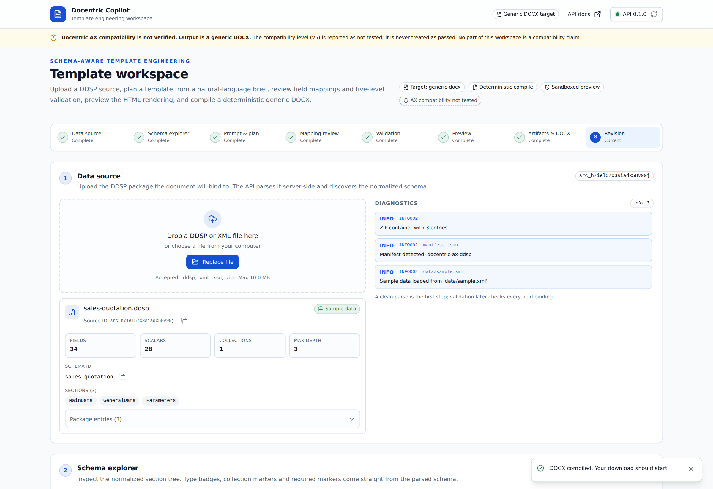

# Quick Start

> A validated DOCX from a synthetic data source in under five minutes — no API key required.

## Prerequisites

- Docker, **or**
- Python 3.12+ (CLI and API) and Node.js 22+ (web workspace)

---

## Option A — Docker (fastest)

```bash
git clone https://github.com/SergeyGer/Docentric-Copilot.git
cd Docentric-Copilot
docker compose up --build
```

| Service | URL |
| --- | --- |
| Web workspace | <http://localhost:3000> |
| API + interactive docs | <http://localhost:8000/docs> |
| Health check | <http://localhost:8000/health> |

The stack ships with the deterministic `mock` planner enabled, so nothing leaves your machine.

---

## Option B — Local CLI

```bash
python3.12 -m venv .venv
source .venv/bin/activate
pip install -e ".[dev]"

docentric-copilot version
# docentric-copilot 0.12.0 (IR 1.0)
```

### 1. Inspect the data source

```bash
docentric-copilot inspect examples/quotation/sales-quotation.ddsp
```

```text
Schema: sales_quotation
Sections: MainData, GeneralData, Parameters
Fields: 34 nodes · 28 scalars · 1 collections · depth 3
Sample data: yes
```

### 2. Plan a template from a brief

```bash
docentric-copilot plan \
  --ddsp examples/quotation/sales-quotation.ddsp \
  --prompt-file examples/quotation/prompt.txt \
  --output plan.json --mapping mapping.json
```

```text
IR written to plan.json (9f8d8ad173de)
Validation: {'structural': 'passed', 'semantic': 'passed', 'logical': 'passed',
             'visual': 'skipped', 'docentric_compatibility': 'not_tested'}
Mapping: {'resolved': 11, 'ambiguous': 0, 'missing': 0, 'invalid': 0}
```

### 3. Validate, compile, preview

```bash
docentric-copilot validate --ddsp examples/quotation/sales-quotation.ddsp --plan plan.json --report report.html
docentric-copilot compile  --ddsp examples/quotation/sales-quotation.ddsp --plan plan.json --output quotation.docx
docentric-copilot preview  --ddsp examples/quotation/sales-quotation.ddsp --plan plan.json --output preview.html
```

`quotation.docx` is a complete document: company logo, customer block, item table with two lines, totals,
conditional VAT notice and bank details in the footer.

---

## Option C — Local web workspace

```bash
# terminal 1 — API
pip install -e ".[dev]"
uvicorn docentric_copilot.api.main:app --reload --port 8000

# terminal 2 — web
cd apps/web
npm ci
npm run dev            # http://localhost:3000
```

The workspace reads `NEXT_PUBLIC_API_BASE_URL` (default `http://localhost:8000`). The API allows
`http://localhost:3000` by default; change `DC_CORS_ORIGINS` if you use another port.



---

## The same flow over HTTP

```bash
SID=$(curl -s -F "file=@examples/quotation/sales-quotation.ddsp" \
  http://localhost:8000/api/v1/sources | jq -r .source_id)

curl -s -X POST http://localhost:8000/api/v1/templates/plan \
  -H "Content-Type: application/json" \
  -d "{\"source_id\":\"$SID\",\"prompt\":\"Create a professional sales quotation\",\"provider\":\"mock\"}" \
  | jq '{validation, template_id, version}'
```

Full contract: [API Reference](API-Reference).

---

## Use a real LLM

```bash
export OPENAI_API_KEY=...
export DC_OPENAI_MODEL=gpt-4o-mini

docentric-copilot plan --ddsp examples/quotation/sales-quotation.ddsp \
  --prompt-file examples/quotation/prompt.txt \
  --provider openai --model gpt-4o-mini --output plan.json
```

Anthropic and Gemini are selected the same way (`--provider anthropic|gemini`). Keys are read from the
environment only; they are never written to logs, the database or the browser.

> **Privacy note:** when you select a cloud provider, the brief and a minimal schema fragment are sent to
> that provider. Sample values are not sent by default. Use the `mock` provider for fully offline work.

---

## Troubleshooting

| Symptom | Cause | Fix |
| --- | --- | --- |
| `provider_not_configured` | No API key for the selected provider | export the key or use `--provider mock` |
| Browser shows a network error | API not running or CORS mismatch | start the API; align `DC_CORS_ORIGINS` with the web origin |
| `target_unsupported` | Asked for `docentric-ax` | expected: the AX adapter is gated, see [Docentric AX Compatibility](Docentric-AX-Compatibility) |
| `SSL`/proxy issues with npm | Corporate proxy | configure `npm config set proxy` / `https-proxy` |

## Live demo

No installation required: open [https://docentric-copilot-bqpx8652tmmliwk9c2d5rq.streamlit.app](https://docentric-copilot-bqpx8652tmmliwk9c2d5rq.streamlit.app) and pick a bundled package.
The demo runs on the deterministic provider and makes no external model calls.
