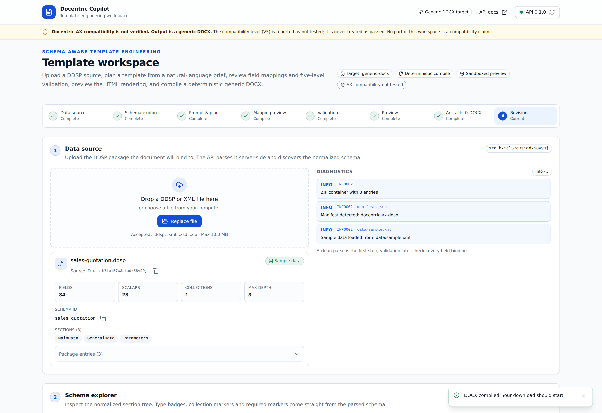

# Web Workspace

> A single-page Next.js 16 application that drives the REST API end to end.



## Running it

```bash
cd apps/web
cp .env.example .env.local     # NEXT_PUBLIC_API_BASE_URL=http://localhost:8000
npm ci
npm run dev                    # http://localhost:3000
```

| Script | Purpose |
| --- | --- |
| `npm run dev` | Development server on port 3000 |
| `npm run build` | Production build |
| `npm start` | Serve the production build |
| `npm run lint` | ESLint (`next lint`) |
| `npm run typecheck` | `tsc --noEmit` |

Or use Docker: `docker compose up --build` (API on 8000, web on 3000).

## Panels

| Panel | What it does | Screenshot |
| --- | --- | --- |
| **Data source** | Upload, parse, inspect diagnostics and stats | [source-panel.png](https://github.com/SergeyGer/Docentric-Copilot/blob/main/docs/assets/source-panel.png) |
| **Schema explorer** | Typed tree, filter, copy/insert path, keyboard navigation | [schema-explorer.png](https://github.com/SergeyGer/Docentric-Copilot/blob/main/docs/assets/schema-explorer.png) |
| **Prompt & provider** | Brief, provider/model, style, language, advanced options | [prompt-panel.png](https://github.com/SergeyGer/Docentric-Copilot/blob/main/docs/assets/prompt-panel.png) |
| **Mapping review** | Requirement → field decisions with candidates and confidence | [mapping-review.png](https://github.com/SergeyGer/Docentric-Copilot/blob/main/docs/assets/mapping-review.png) |
| **Validation** | V1–V5 badges, checks and findings | [validation.png](https://github.com/SergeyGer/Docentric-Copilot/blob/main/docs/assets/validation.png) |
| **Preview** | Sandboxed HTML preview | [preview.png](https://github.com/SergeyGer/Docentric-Copilot/blob/main/docs/assets/preview.png) |
| **Artifacts** | Compile DOCX, download the bundle | [artifacts.png](https://github.com/SergeyGer/Docentric-Copilot/blob/main/docs/assets/artifacts.png) |
| **Revision** | Natural-language change, diff, version history | [revision.png](https://github.com/SergeyGer/Docentric-Copilot/blob/main/docs/assets/revision.png) |

## Design rules the UI follows

1. **Compatibility is never green.** V5 is always shown as `not tested` with a dashed neutral badge.
2. **The archive is visible.** A persistent amber banner states that output is a generic DOCX.
3. **Evidence beats confidence.** The mapping table always shows schema evidence next to the score.
4. **Nothing hidden behind hover.** Every status is text plus colour, never colour alone.
5. **Keyboard first.** The schema tree is fully operable with arrows, `Enter`, `C` (copy) and `I` (insert).

## Security posture

| Control | Implementation |
| --- | --- |
| No HTML injection | The preview is rendered in `<iframe sandbox="">` with `srcdoc` |
| No token exposure | Keys stay server-side; the UI only receives provider availability |
| Safe downloads | Artifacts are fetched as blobs, served as attachments |
| Headers | `X-Content-Type-Options`, `X-Frame-Options`, `Referrer-Policy`, `Permissions-Policy` |
| Error hygiene | API error codes/messages are shown, stack traces are not |

A strict Content-Security-Policy is tracked in the [Threat Model](Security-and-Threat-Model) as residual risk R-13.

## Accessibility

- Semantic landmarks and labelled controls.
- Skip link, visible focus rings, 1024 px minimum supported width.
- Status conveyed by text and icon, not only colour.
- Verified with keyboard navigation during the manual browser test.

## Not implemented (by design)

- Authentication and multi-user sessions.
- Server-side rendering of user data.
- PDF export from the UI.
- Browser E2E tests committed to CI (manual Playwright smoke test only; see [Testing](Testing)).
